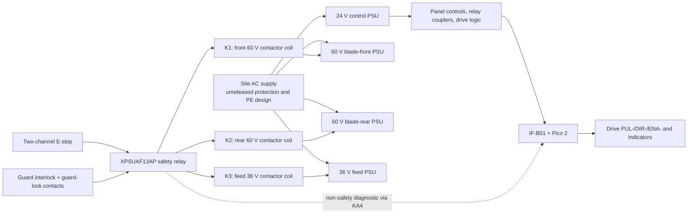

# Controls and cabinet electrical design input — S1-B

**Revision:** `S1-B-CTRL-CAB-R2-2026-09-13`  
**Status:** **engineering design input only — not released for fabrication, energisation, production, or personnel-safety use.**

This document records the intended hardwired control and safety topology for
one S1-B machine. It is a controlled design input for schematic capture,
review, cabinet construction planning, and subsequent physical qualification.
It is not an approved electrical drawing, a risk assessment, a verification
record, or a safety certificate. No assembled IF-B01 board, cabinet, motor
power interruption, guard-lock release circuit, stop-time measurement, EMC
assessment, PE-continuity test, insulation test, or safety-function validation
exists at this revision.

The safety relay component capability must not be relabelled as an achieved
machine performance level or SIL. Work on mains, PELV distribution, safety
circuits, and guarded machinery requires review and execution by competent
persons under the applicable local regulations.

## 1. Governing records and boundary

| Record | Purpose | Status at this revision |
|---|---|---|
| [controls specification](../shared/controls_spec.hpp) | Target GPIO polarity, timing and selected interface intent | Source authority for controller-facing signals |
| [IF-B01 native schematic](../hardware/if-b01/if-b01.kicad_sch) | Editable KiCad logical capture | Draft source with clean ERC/native-netlist parity; not a reviewed or released design |
| [IF-B01 netlist](../hardware/if-b01/if-b01-netlist.csv) | Controlled connector-to-net design input | Reconciled to the native export; not a fabrication netlist |
| [IF-B01 GPIO allocation](../hardware/if-b01/if-b01-gpio-allocation.csv) | Machine-readable connector/net/controller allocation | Reconciled by source check; not a physical wiring or safety validation |
| [IF-B01 component list](../hardware/if-b01/if-b01-bom.csv) | Controlled board-component design input | Reconciled to the native KiCad BOM; not a fabrication BOM |
| [IF-B01 PCB DRC](../hardware/if-b01/review/if-b01-pcb-drc.rpt) | KiCad physical and schematic-parity check of the placed/routed four-layer draft board | Zero physical violations, zero unconnected pads and zero schematic-parity issues; not a human layout/fabrication approval |
| [IF-B01 draft outputs](../hardware/if-b01/manufacturing/draft-r2-2026-09-13) | Verification-gated Gerber, drill, placement, visual assembly, board-only STEP, IPC-D-356, BOM and SHA-256 package | Explicitly draft only; not an order, build or release authorisation |
| [IF-B01 cabinet integration](../hardware/if-b01/if-b01-cabinet-integration.md) | Exact board-terminal / relay-contact cabinet schedule | Draft connection source; not a released wiring drawing |
| [cabinet wiring BOM](../bom/selected-cabinet-wiring.csv) | Selected-device cross-references and explicit terminal/protection holds | Not a procurement authorisation |
| [cabinet assembly plan](23-cabinet-electrical-assembly.md) | De-energised installation sequence and mandatory physical records | Not a released assembly or energisation procedure |
| [controls selection BOM](../bom/selected-controls.csv) | Procurement identities and release holds | Current controls selection record |
| [manufacturer evidence](../engineering/sources/catalogue-evidence.md) | Catalogue facts and source links | Evidence archive, not a machine validation record |
| [physical qualification procedure](20-physical-qualification.md) | Required records after assembly | Blank; no qualification has been performed |
| [master production/release plan](24-production-and-release-plan.md) | Ordered work packages, incoming/FAI templates and source evidence gates | Source-controlled plan; not a release authority |
| [preliminary guard/payoff CAD](25-preliminary-guard-and-payoff.md) | Static guard-lock/spool accommodation and external wire-route geometry | Not a guard design, release or safety-function validation |

IF-B01 is a PELV/SELV interface between the Pico 2 and low-voltage external
signals. It carries neither mains nor a safety function. It must not be used
as the means of emergency power removal. The hardwired XPS safety relay and
three DC contactors are the proposed power-removal path; that path remains
unreleased until the open items in section 10 are closed.

The diagram identifies functional relationships only. It is not a physical
routing drawing and does not approve the AC supply, wire sizes, terminal
products, protective devices, supply fusing, DC bus discharge, regenerated
energy path, enclosure, or thermal design.

## 2. Power domains and intended power removal

| Domain | Selected source | Intended load | Required state / release hold |
|---|---|---|---|
| `+24V_PELV` | Siemens `6EP3332-6SB00-0AY0`, 24 VDC / 2.5 A | XPS relay, panel controls, relay couplers, drive-input anodes, indicators and IF-B01 low-voltage interface | Distribution, load calculation, branch protection and wiring are not released |
| `+5V_LOGIC` | Siemens `6EP3310-6SB00-0AY0`, 5 VDC / 3 A | Pico `VSYS` and encoder branches through IF-B01 | Distribution and short-circuit coordination are not released |
| `+60V_BF` | one `LE-350-60` | blade-front CL86T driver power | K1 is the proposed isolation contactor; DC interrupting duty is unproven |
| `+60V_BR` | second, isolated `LE-350-60` | blade-rear CL86T driver power | K2 is the proposed isolation contactor; DC interrupting duty is unproven |
| `+36V_FEED` | one `LE-350-36` | both CL57T feed-driver branches | K3 is the proposed isolation contactor; DC interrupting duty is unproven |
| PE / AC | site installation | chassis, supplies, cooler and mains-fed equipment | No complete design or acceptance record exists |

The two 60 V supplies must remain electrically separate; they are not to be
paralleled. The 36 V feed supply remains separate from both 60 V supplies.

The proposed K1/K2/K3 contacts are Schneider Electric `LC1D12BD`, each with a
24 VDC coil, three main normally-open poles (`1/L1-2/T1`, `3/L2-4/T2`,
`5/L3-6/T3`), a NO auxiliary (`13-14`) and a mirror-certified NC auxiliary
(`21-22`). The design concept uses all three main poles in series in the
positive branch of that contactor's DC supply. This is **not** a released
36 VDC or 60 VDC interruption design: available product material establishes a
power-circuit voltage limit but does not establish the required DC utilisation
category/current/duty for this exact series-pole application. Do not energise
this arrangement until an applicable manufacturer rating, branch protection
coordination, switching test and DC-bus measurement have been reviewed.

The proposed assignments are:

| Contactor | Supply isolated by proposed main-pole series chain | Safety-output coil command |
|---|---|---|
| K1 | blade-front `LE-350-60` positive branch | XPS `13-14` |
| K2 | blade-rear `LE-350-60` positive branch | XPS `23-24` |
| K3 | feed `LE-350-36` positive branch | XPS `33-34` |

The selected XPS documentation specifies a 10 A gG external fuse for its
safety output circuit. Schneider Electric `DF2CN10` is an identified matching
10 × 38 mm, 500 VAC, 10 A gG fuse link. Its compatible holder, DC branch
coordination, prospective-fault assessment and installation are still release
holds. `C10G` is not selected for this machine; it is an Eaton Bussmann series,
not a Mersen or Schneider designation.

## 3. Safety relay configuration and two-channel inputs

### 3.1 Selected XPS configuration

The selected device is Schneider Harmony `XPSUAF13AP`, supplied at `A1/A2`
from 24 VAC/DC with `B2` as the 0 V reference for 24 V control signals. The
proposed selector settings are:

| XPS setting | Proposed value | Reason |
|---|---:|---|
| Application-function selector | `1` | Monitors two safety input channels for E-stop / electrical guard use with input dynamisation and interlock monitoring |
| Start-function selector | `3` | Monitored falling-edge start with dynamisation; a start pulse must be held for at least 80 ms and is accepted on release after the device's stated power-on delay |

The following terminal roles are used exactly as named by the XPS documentation:
`S11` / `S21` are the two safety-input test/control outputs; `S12` / `S22`
are the two safety-input channels; `Y1` / `Y2` form the start/feedback path;
and `13-14`, `23-24`, `33-34` are the three normally-open safety outputs.
`Z1` is a **non-safety diagnostic output** and must never be used as a safety
signal, a safety-input substitute, or an actuator-power source.

### 3.2 Proposed dual-channel safety loop

The E-stop is Siemens `3SU1851-0NB00-2AC2` with two independent NC contacts.
The guard device is Bernstein `SLC-F-024-20/20-R4`, article `6018200007`,
with the compatible `ACF-1` actuator, article `3911742391`. Its contact state
is material to the topology:

- `11-12` and `21-22` are NC guard-interlock contacts closed while the actuator
  is inserted, whether the guard is locked or unlocked.
- `31-32` and `41-42` are NC guard-lock contacts closed only while the actuator
  is inserted **and** the guard is locked.
- The locking magnet is a 24 VAC/DC `E1/E2` load; spring force retains the
  locked state on loss of its supply.

The draft channel paths are therefore:

| Channel | Series path | Expected healthy condition |
|---|---|---|
| CH1 | `S11 → E-STOP CH1 NC → SLC 11-12 → SLC 31-32 → S12` | E-stop released, actuator inserted and guard locked |
| CH2 | `S21 → E-STOP CH2 NC → SLC 21-22 → SLC 41-42 → S22` | E-stop released, actuator inserted and guard locked |

Opening either E-stop channel, either guard-interlock contact, either
locked-state contact, or the associated wire must remove the safety-relay
output according to the device's evaluated safety function. The XPS catalogue
response specification (maximum 20 ms on safety-input deactivation) is a
component property; it is **not** a verified K1/K2/K3 opening time or machine
stopping time.

### 3.3 Start/reset and external-device monitoring path

`PB03` is the blue RESET/ACK pushbutton. Its one NO contact must not be reused
as one contact path for two unrelated functions. The proposed design uses two
distinct downstream relay coils in parallel, each with its own function:

| Device | Coil command from PB03 | Contact function | Prohibited use |
|---|---|---|---|
| KA3 | `+24V_PELV → PB03 NO → KA3 coil → 0V_PELV` | KA3 NO contact reports the local reset pushbutton to IF-B01 `GP14` | Do not route XPS `Y1/Y2` through KA3 |
| KSR1 | `+24V_PELV → PB03 NO → KSR1 coil → 0V_PELV` | KSR1 NO forms the independent XPS start pulse | Do not use KSR1 as the GPIO monitor |

The proposed XPS feedback/start chain is:

`Y1 → KSR1 NO → K1 21-22 NC → K2 21-22 NC → K3 21-22 NC → Y2`

The three contactor NC auxiliaries form the external-device monitoring chain.
KSR1 must drop when PB03 is released so the XPS sees the required monitored
falling edge. KSR1 is a separately required 24 V interposing relay; the current
procurement intent is a further Phoenix Contact `PLC-RSC-24DC/21` relay coupler
only if its coil load, contact function, installation and safety-function
suitability are accepted during detailed design. This is not an approval of
that relay as a safety-rated component.

### 3.4 Non-safety diagnostic to the controller

KA4 is separate from KSR1 and KA3. Its proposed coil is placed in parallel
with the K1-coil command downstream of XPS `13-14`; KA4's isolated NO contact
then closes IF-B01 `J10-7` to `J10-8` / `0V_PELV`. The controller reads the
result at active-low `GP15` (`IN_SAFETY_OK`). KA4 means only that this one XPS
output branch is energised; it does **not** prove that every contactor opened
or closed, that DC buses are at a safe voltage, or that the guard may unlock.
KA4, IF-B01, `GP15`, firmware and USB are diagnostic only and are not part of
the safety function.

The coil current of KA4 and KSR1, XPS output loading, contactor-coil inrush,
24 V PSU loading and protective-device coordination must be calculated and
measured before release. The `LC1D12BD` coil data identifies a 24 VDC coil with
5.4 W maximum coil consumption; even the simple upper-bound arithmetic
$3 \times 5.4\ \mathrm{W} / 24\ \mathrm{V} = 0.675\ \mathrm{A}$ does not close
that calculation because it excludes KA4, KSR1, the XPS, field relays,
indicators, board loads and transient conditions.

## 4. Guard unlocking is deliberately unresolved

The SLC `E1/E2` lock-release coil has **no authorised final power path** in
this revision. It must not be permanently energised, wired directly to a
convenience switch, or driven from an unreviewed GPIO output merely to make
the guard easier to open. A separate release-permission design is required,
including at least:

1. risk assessment of stored mechanical, electrical and thermal energy;
2. a verified safe-voltage / safe-motion condition after K1/K2/K3 open;
3. controlled operator request and prevention of unintended restart;
4. fault-state behavior, power-loss behavior and escape/rescue considerations;
5. measured contactor opening and DC-bus decay on the assembled machine.

Until that design is accepted, access after a trip is a controlled maintenance
procedure under the applicable lockout/tagout process, not an automatic
software or electrical unlock feature.

## 5. Front-panel and field-interface intent

`STOP` is a normal software stop request, not a safety device and not a
substitute for the E-stop. It is intentionally separate from the XPS
safety-input channels. The controller must still latch a hardware safety-loop
loss and force the driver-enable command low, but that firmware behavior does
not replace hardwired contactor power removal.

| Function | Proposed 24 V field path | Isolated relay contact to IF-B01 | Controller polarity |
|---|---|---|---|
| START, PB01 NO | `+24V_PELV → PB01 NO → KA1 coil → 0V_PELV` | KA1 NO: `J10-1` to `J10-2` | `GP12` low while pressed |
| STOP, PB02 NC | `+24V_PELV → PB02 NC → KA2 coil → 0V_PELV` | KA2 NO: `J10-3` to `J10-4` | `GP13` low while STOP loop is healthy |
| RESET/ACK, PB03 NO | PB03 operates KA3 and KSR1 as described in section 3.3 | KA3 NO: `J10-5` to `J10-6` | `GP14` low while pressed |
| XPS diagnostic | KA4 coil downstream of `13-14`; see section 3.4 | KA4 NO: `J10-7` to `J10-8` | `GP15` low while KA4 is energised |
| Rear home | Selected PNP sensor drives KA5 coil subject to output-current review | KA5 NO: `J10-9` to `J10-10` | `GP16` low at rear open position |
| Front home | Selected PNP sensor drives KA6 coil subject to output-current review | KA6 NO: `J10-11` to `J10-12` | `GP27` low at front open position |
| BF driver alarm | Driver ALM interface drives KA7 coil subject to load review | KA7 NO: `J11-1` to `J11-2` | `GP18` low on alarm |
| BR driver alarm | Driver ALM interface drives KA8 coil subject to load review | KA8 NO: `J11-3` to `J11-4` | `GP19` low on alarm |
| FL driver alarm | Driver ALM interface drives KA9 coil subject to load review | KA9 NO: `J11-5` to `J11-6` | `GP20` low on alarm |
| FR driver alarm | Driver ALM interface drives KA10 coil subject to load review | KA10 NO: `J11-7` to `J11-8` | `GP21` low on alarm |

KA1–KA10 are ten isolated field/alarm functions. They are not six functions;
any controls BOM or cabinet layout allocating only six relay couplers is
incorrect. Their exact board-side pair allocation is authoritative in the
[IF-B01 netlist](../hardware/if-b01/if-b01-netlist.csv).

## 6. IF-B01 cabinet connections

The following is a cabinet-interconnect schedule, not a substitute for a
reviewed PCB schematic. Connector pin names and ordering must be read from the
[IF-B01 netlist](../hardware/if-b01/if-b01-netlist.csv); no connection may be
inferred solely from connector position.

| Board connection | Cabinet source / destination | Design constraint |
|---|---|---|
| J3 | `TB24-01 +24V_PELV`, `TB24-02 0V_PELV`, `TB24-03 +5V_LOGIC`, `TB24-02 0V_PELV` | Board power only; actual terminal product and branch protection are release holds |
| J4–J7 | One labelled CL86T/CL57T drive each | IF-B01 sinks `PUL−`, `DIR−`, `ENA−`; common-anode positives come from separately protected `+24V_DRVLOGIC` cabinet wiring and are never routed through IF-B01 |
| J8–J9 | Left/right E40S6 measuring encoders | 5 V through board PTCs; A/A-bar and B/B-bar are differential pairs; Z/Z-bar are individually insulated and not connected |
| J10 | KA1–KA6 isolated contact pairs | Inputs close only to `0V_PELV`; no 24 V field voltage reaches Pico GPIO |
| J11 | KA7–KA10 isolated alarm-contact pairs | Inputs close only to `0V_PELV`; no 24 V driver-alarm voltage reaches Pico GPIO |
| J12 | PB01 green LED cathode, PB02 red LED cathode and buzzer negative | Their positive terminals use separately protected `+24V_PELV`; IF-B01 uses low-side channels |

Provisional terminal **designations** preserve the existing netlist references;
they are not selected terminal-block products:

| Designation | Defined net / function | Release state |
|---|---|---|
| TB24-01 | protected `+24V_PELV` to IF-B01 J3-1 | Terminal, wire and fuse coordination unselected |
| TB24-02 | `0V_PELV` common to IF-B01 J3-2/J3-4 and contact returns | Terminal and return-current design unselected |
| TB24-03 | protected `+5V_LOGIC` to IF-B01 J3-3 | Terminal and fuse coordination unselected |
| TB-DL | separately protected `+24V_DRVLOGIC` common-anode drive input supply | Fuse rating, terminal product and branch wiring unselected |
| TB-S | XPS / E-stop / guard field-loop terminations | Exact terminals, cable and cross-wire arrangement require schematic review |
| TB-M1 / TB-M2 / TB-M3 | K1 / K2 / K3 DC supply and drive branch terminations | DC switching, fusing, discharge and wire sizing unselected |
| PE-BAR | chassis, cable-screen entry and protective-earth bonds | Bar, conductor, enclosure and test plan unselected |

## 7. Signal integrity and segregation requirements

- Route RS-422 encoder pairs as pairs from J8/J9 to their respective encoders.
  Bond each encoder cable screen to the cabinet PE bar at the metal cable entry;
  do not bond the screen to IF-B01 `0V_PELV`.
- Keep the two unused encoder Z conductors individually insulated at the board
  plug. Do not join them to `0V_PELV`, the screen or each other.
- Maintain physical segregation between AC/mains, switched 36/60 V drive
  power, low-voltage relay wiring, USB and differential encoder cables. Final
  distances, ducts, shield terminations and EMC components require enclosure
  and standards review.
- Treat 24 V field relay coils and dry-contact return pairs as distinct from
  the 3.3 V GPIO side. IF-B01's protected active-low inputs accept only the
  isolated contact closure to `0V_PELV`.
- Do not use IF-B01's 100 kΩ `GP17` pull-down, controller watchdog, PIO abort,
  USB disconnection or software STOP command as safety-energy isolation.

## 8. Required staged verification

No stage authorises the next one automatically; measured records and design
review are required.

1. **Native-source and document review:** the editable logical schematic and
  $750\times400\ \mathrm{mm}$ placed/routed, four-layer IF-B01 draft have
  clean KiCad ERC, native-parity and physical/schematic-parity DRC results.
  Complete human electrical/mechanical review and resolve actual footprints,
  terminals, fuses, holders, wire sizes, enclosure, PE, fabricator stack-up and
  panel capability before fabrication.
2. **Unpowered IF-B01 fixture:** inspect a produced board and follow the
   [fixture procedure](../hardware/if-b01/if-b01-test.md) using only the
   dedicated `if-b01-factory-test.uf2` image. J4–J7 must remain unplugged from
   production motor drivers.
3. **Cabinet de-energised inspection:** point-to-point continuity, separation,
   PE continuity, terminal torque/marking and insulation tests under the
   applicable requirements. Record actual instrument identities and results.
4. **Safety-function verification:** test each E-stop channel, both guard
   contact paths, cross-wire faults, reset/EDM behavior and each contactor
   fault mode with a reviewed test plan. Verify the XPS function; do not infer
   system performance from a panel indicator or `GP15`.
5. **Energy verification:** measure K1/K2/K3 opening behavior, all driver-bus
   voltages, regenerated-energy behavior and time to the risk-assessed safe
   condition before enabling any guard-release design.
6. **Machine qualification:** after guards, wire handling and all controls are
   assembled, execute the actual records required by
   [physical qualification](20-physical-qualification.md). Blank or synthetic
   records do not qualify a machine.

## 9. Firmware relationship

The production RP2350 target implements a raw active-low `GP15` safety-loss
interrupt that immediately drives the shared enable low and resets its step
state machines. It also supervises the resulting input in the controller.
This is a useful additional control-layer response, not the safety function.
The contactor circuit must remove motor supply independently of Pico firmware,
its watchdog, IF-B01, USB and the host commissioning tool.

The dedicated `if-b01-factory-test.uf2` target exists only for a bare-board
fixture. It starts with all TPL inputs low, requires active-low `SAFETY_OK` and
held active-low `RESET` before it permits a test output, limits an armed window
to 30 s and limits each asserted output to 3 s. It is not production firmware
and must never be used on the assembled machine.

## 10. Release holds

The following remain open and prevent electrical release or energisation:

1. IF-B01 electrical/mechanical review of the current placed/routed draft;
  fabricator confirmation for its panel, stack-up, footprint and assembly
  constraints; bare-board inspection, assembly and recorded fixture evidence;
2. confirmed `LC1D12BD` DC utilisation/rated switching duty for the exact
   36/60 V three-series-pole loads, plus measured switching behavior;
3. DC branch fuses, holders, wire ampacity, short-circuit coordination,
   inrush, regenerated-energy limitation and bus-discharge design;
4. AC incoming disconnect/protection, enclosure, terminal-block system, cable
   glands, PE bonding, cooling/airflow and applicable local-regulation design;
5. final E1/E2 guard-release-permission circuit and risk assessment;
6. full safety-function validation, including fault injection, stop time and
   contactor/bus decay measurements on assembled hardware;
7. actual IF-B01, USB, encoder, field I/O, contactor and driver commissioning;
8. completion of the blank physical machine qualification records.

Until every applicable hold is formally closed with evidence, this document
must be read as a cautious design baseline rather than permission to build or
energise the machine.

## 11. Cabinet identity proposal (procurement intent, not selections)

The following exact identities are proposed to close the `UNSELECTED` cabinet
rows. They are procurement intent only: each requires direct catalogue-page
verification, the electrical protection/schematic review of section 10 and an
approved change record before it becomes a selected identity. None is
purchased or priced here.

| Hold row | Proposed identity | Manufacturer part | Function | Remaining review |
|---|---|---|---|---|
| CB-TB24-01 / CB-TB24-02 | Phoenix Contact PT 2,5 feed-through terminal, grey, 0.2–2.5 mm² | 3209510 | 24 V PELV distribution and 0 V common | Branch protection, return-current capacity, 24 V load calculation |
| CB-TB24-03 | Phoenix Contact PT 2,5 feed-through terminal, blue | 3209523 | 5 V logic distribution | 5 V branch protection and voltage-drop check |
| CB-TB-DL | Fused terminal for the drive-logic common-anode branch | Wago 282-364 (10×38) or Phoenix UT 4-HESI — identity to be confirmed against the live catalogue | separately fused +24V_DRVLOGIC | Drive-logic load sum, fuse rating selection |
| CB-XPS-FUSE holder | Schneider DF2CA DIN-rail 10×38 holder (identity to be confirmed) | DF2CA | Holds the DF2CN10 gG link | Prospective-fault level, DC coordination, physical fit |
| CB-TB-S | Safety-loop field terminations using PT 2,5 or UT 2,5 terminals in a dedicated red/separated group | — | E-stop and guard channel wiring | Cross-wire fault review per section 3 |
| CB-TB-M1-M3 | UT 4 terminals, one 4-terminal group per DC branch | Phoenix UT 4 3044131 | K1/K2/K3 DC branch terminations | DC current rating, wire ampacity, discharge design |
| CB-PE-BAR | Copper PE bar with 10×3 mm busbar on insulated supports, M6 bonds | — | Chassis, screens, supply PE | PE continuity test plan, conductor sizing |
| CB-ENC-ENTRY | 2 × metric M20 metal cable glands with EMC shield contact (Lapp Skintop MS-M or Pflitsch blueglobe equivalent, identity to be confirmed) | — | Encoder cable entry with screen bond to PE bar | EMC review, gland plate position |
| CB-WIRE-FERRULES | H07V-K 0.75/1.5/2.5 mm² wiring (black/red/blue/green-yellow per circuit) with insulated ferrules and a crimp tool | — | Cabinet wiring | Wire-size calculation against final protection, torque records |
| HOLD-TERMINALS-PE-ENCLOSURE | Rittal AE-series wall-mount enclosure, ≥ 800×600×210 mm, steel, single door, mounting plate | size to be confirmed from the 750×400 mm IF-B01 board plus K1–K3, three PSUs, XPS and terminal layout | Cabinet | Thermal load sum, door/plate layout, PE bonding, cooling |

The three motor supplies carry a combined 1050 W of rated DC output power
(2 × 350 W at 60 V, 1 × 350 W at 36 V); their actual heat dissipation depends
on operating load and efficiency and is unmeasured. The 280 W cooler (TH-C01)
rating and any conduction margin therefore do not establish the enclosure
thermal design, which remains a calculated gate, not a completed calculation.
AC incoming disconnect, branch circuit breakers and RCD remain unselected and
are not inferred by this proposal.

Direct verification notes 2026-09-13: phoenixcontact.com, se.com and
wago.com blocked automated retrieval from this environment; the part numbers
above are catalogue identities to be verified on live pages before selection,
and no price is observed for any row in this table. This does not weaken the
section 10 holds.
